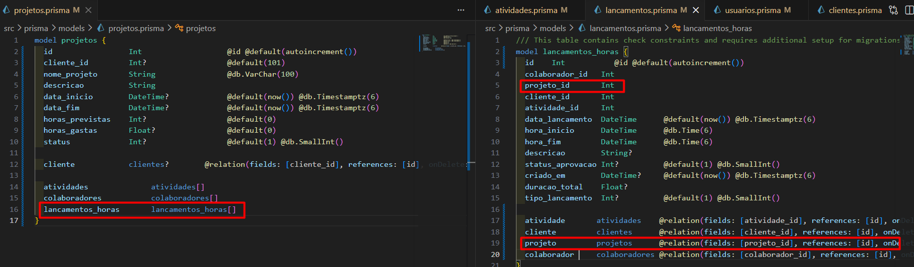
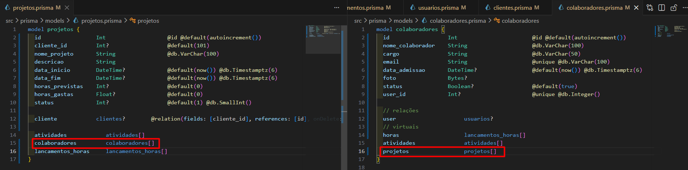
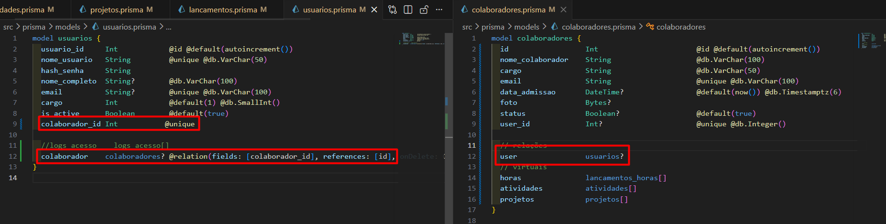

# Relacoes prisma

## ManyToOne (N:1) | OneToMany (1:N)
- Lado N, no model, recebe a fk e criamos a notation @relation(). Sera o com varios registros.
- Lado 1, no model, recebe apenas a lista do que vai ser relacionado. Apenas um registro por id.
- _Nao usar @Unique no Lado 1 na coluna que carrega a relacao._

Na pratica: um projeto (Lado 1) tem varios lancamentos (Lado N)

## ManyToMany (N:N)
- Ambos lados N carerega um array do tipo do modelo que sera relacionado, como no exemplo, existem N projetos para N colaboradores.
- O Prisma gerencia esta relacao, criando uma tabela intermediaria. 

## OneToOne (1:1)
- Indifere o lado que vai receber o @relation, entretanto aquele que recebe deve anotar a coluna que fara a relacao com @unique. 
- O outro lado apenas recebe um campo virtual para confirmar a relacao, sem ser uma lista!

